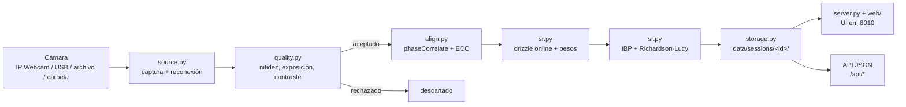
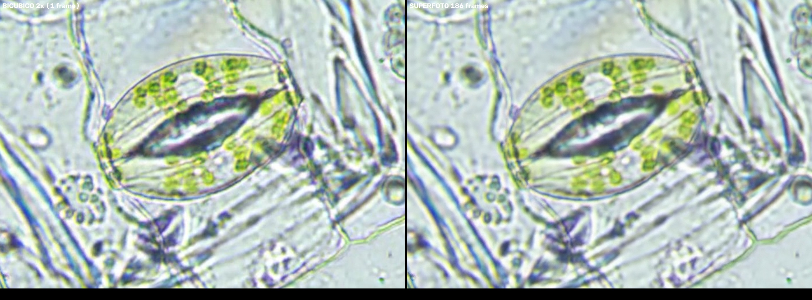
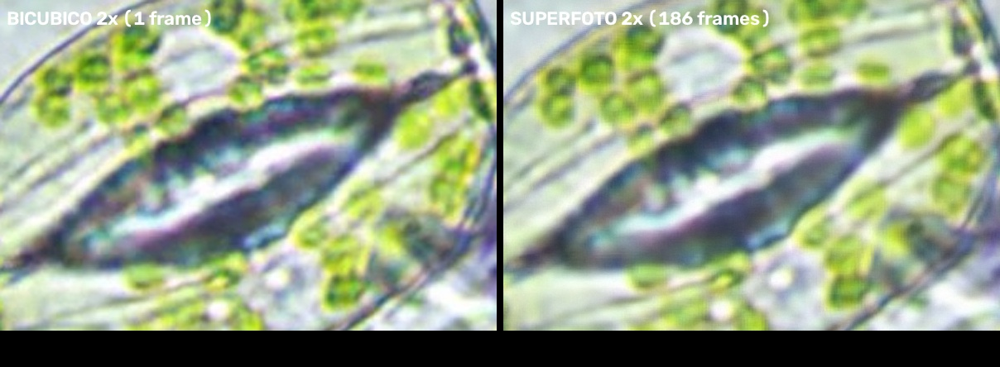

# SuperFoto UNO Q

**Superfotografía por fusión de miles de frames, corriendo en una Arduino UNO Q.**

SuperFoto captura un video de un objeto inmóvil, se queda con los frames más
nítidos (*lucky imaging*), los alinea con precisión subpíxel y los fusiona en
una sola imagen con **más detalle, menos ruido y hasta 4× más píxeles** que un
frame individual. La imagen se puede inspeccionar, comparar y descargar desde el
navegador, o procesar por CLI sin interfaz.

No es un microscopio óptico ni un escáner. Es un pipeline de superresolución
multi-frame honesto: aprovecha la diversidad de muestreo subpíxel y el
promediado de ruido, y recupera parte del desenfoque de la PSF por
deconvolución. Hasta dónde llega, y por qué, está documentado en
[`docs/limites-y-alcance.md`](docs/limites-y-alcance.md).

---

## Índice

- [El problema que resuelve](#el-problema-que-resuelve)
- [Cómo funciona](#cómo-funciona)
- [Hardware y conexiones](#hardware-y-conexiones)
- [Arquitectura y flujo de datos](#arquitectura-y-flujo-de-datos)
- [Resultados medidos](#resultados-medidos)
- [Comparativa visual real](#comparativa-visual-real)
- [Instalación y despliegue](#instalación-y-despliegue)
- [Servicio: iniciar, detener y arranque automático](#servicio-iniciar-detener-y-arranque-automático)
- [Forma de operar](#forma-de-operar)
- [API HTTP](#api-http)
- [CLI](#cli)
- [Sketch del STM32 (matriz LED)](#sketch-del-stm32-matriz-led)
- [Calibración y recomendaciones](#calibración-y-recomendaciones)
- [Solución de problemas](#solución-de-problemas)
- [Tests y benchmark](#tests-y-benchmark)
- [Estructura del repositorio](#estructura-del-repositorio)
- [Advertencias y límites](#advertencias-y-límites)
- [Licencia y créditos](#licencia-y-créditos)

---

## El problema que resuelve

Una cámara de teléfono o una webcam tiene un límite físico: el sensor muestrea
la escena en una grilla finita y la óptica desenfoca lo que queda por debajo de
ese límite. Además, cada frame individual tiene ruido. Cuando el objeto está
quieto, en cambio, se pueden tomar **miles de frames del mismo campo** y
explotar dos hechos:

1. La cámara y el objeto nunca están perfectamente quietos: cada frame cae en
   una **fase subpíxel distinta**. Eso es información extra de muestreo.
2. El ruido del sensor es **independiente entre frames**: promediar N frames
   reduce el ruido en √N.

SuperFoto implementa ese pipeline completo — captura, selección, alineación,
fusión, refinamiento y deconvolución — en el lado Linux de la UNO Q, y lo
expone como una aplicación web y una API. El caso de uso típico es
**microscopía de aficionado, macrofotografía, documentación de muestras o
digitalización de objetos planos**: cualquier escena inmóvil, bien iluminada y
con la cámara fija.

> **Qué NO es.** No supera el límite de difracción del objetivo, no inventa
> detalle que el sensor no muestreó, no congela movimiento y no compensa
> cambios de exposición entre frames. El zoom de 8× de la interfaz es
> **digital**. La ganancia realista es hasta **~2× lineal (4× píxeles)** más la
> reducción de ruido y la mejora de contraste por deconvolución.

---

## Cómo funciona

### 1. Diversidad de muestreo subpíxel

Con la cámara fija y el objeto quieto, las vibraciones mínimas (aire,
estabilizador, pulso) desplazan cada frame una fracción de píxel. Al registrar
esos desplazamientos y recolocar cada frame en una grilla de salida más fina
(escala S entre 1.0 y 2.0), se obtiene un muestreo más denso que el nativo.
Esto es *drizzle*: no se interpola la imagen final, se **depositan** los píxeles
medidos en una grilla de mayor resolución.

### 2. Lucky imaging

No todos los frames sirven. El gate de calidad mide la **varianza del
Laplaciano** en el 50 % central de cada frame (a resolución nativa), detecta
sobreexposición y bajo contraste, y calcula un umbral adaptativo por percentil
sobre la propia sesión. Los frames borrosos, movidos o quemados se descartan
antes de fusionar. En la prueba real de microscopio se aceptaron **186 de 487**
frames; en un video inestable, apenas 7 de 1250.

### 3. Alineación de fase + ECC

Cada frame se registra contra el primero aceptado:

- **Etapa 1 — correlación de fase** (`cv2.phaseCorrelate`) sobre gris a 1/2 de
  resolución, con ventana de Hann para reducir artefactos de borde. Da una
  traslación subpíxel gruesa (error típico ~0.2 px).
- **Etapa 2 — refinamiento ECC** sobre un recorte central de hasta 360 px a
  resolución nativa, inicializado con la traslación anterior. El error baja a
  ~0.04 px.

El resultado es una matriz afín 2×3 que mapea el frame móvil al frame de
referencia. Se rechazan frames con desplazamiento mayor a 32 px o correlación
menor a 0.35: eso evita mezclar campos distintos cuando la escena se mueve.

### 4. Fusión online (drizzle) + refinamiento IBP

Cada frame aceptado se reproyecta a la grilla de salida con
`warpAffine` (Lanczos4) y se acumula con un peso que combina nitidez y
exposición:

```
peso = clip((nitidez / umbral)^0.5, 0.3, 3.0)
     × clip(1 - 2·clipping, 0.4, 1.0)
```

Además se guarda un acumulador de pesos y un contador uint16 por píxel, que
producen el **mapa de cobertura**: qué zonas tienen suficientes muestras
subpíxel. El refinamiento **IBP** (*iterative back-projection*) simula el
proceso de captura — desenfoca y reproyecta la estimación a cada frame de baja
resolución — y corrige la imagen de alta resolución para que sea consistente con
los datos medidos. IBP es lo que impone la física del muestreo; la fusión sola
no alcanza.

### 5. Deconvolución Richardson-Lucy

El desenfoque óptico se modela como una PSF gaussiana (`psf_sigma`, 0.6 por
defecto). Richardson-Lucy se aplica **solo a la luminancia** (en espacio Lab),
con 15 iteraciones por defecto y una ganancia limitada para no amplificar
ruido. Después se aplica un denoise suave de croma y, opcionalmente, un unsharp
multiescala. El orden es: balance de blancos → RL → unsharp → croma.

### 6. Límite físico

La deconvolución recupera frecuencias que la óptica atenuó, pero no las que
eliminó. Si el objetivo no resuelve dos puntos, ningún algoritmo los separa.
Por eso el resultado se compara siempre contra el **bicúbico de un solo frame**
—lo que hace un visor normal— y no contra el ground truth perfecto.

---

## Hardware y conexiones

### Placa

| Característica | Valor |
|---|---|
| Placa | **Arduino UNO Q** |
| MCU | STM32U585xx, ARM Cortex-M33 con TrustZone |
| Memoria MCU | 262 KB RAM, 2 MB flash |
| Lado Linux | QCC711, Debian 13 aarch64 |
| RAM Linux | 3.6 GB (~2.4 GB libres en las pruebas) |
| Almacenamiento | 9.8 GB eMMC (~771 MB libres al momento de las pruebas) |
| Lógica | **3.3 V** |
| RTOS del sketch | **Zephyr RTOS** |
| FQBN | `arduino:zephyr:unoq` |
| Core | `arduino:zephyr` |
| Matriz LED | 13×8, escala de grises de 3 bits (0–7) |
| Puerto del servicio | **8010/TCP** |

La aplicación pesada corre en el **lado Linux**. El STM32 solo anima la matriz
LED de estado; si el sketch no está cargado, la app Linux funciona igual.

### Cámara

| Fuente | Cómo se conecta | Cuándo usarla |
|---|---|---|
| **IP Webcam** (Android) | Teléfono y UNO Q en la misma WiFi; `http://<IP_DEL_TELEFONO>:8080` | Recomendada: todavía de resolución completa y stream MJPEG |
| **Webcam USB (UVC)** | Puerto USB host de la placa | Cuando se quiere una cámara fija y no hay teléfono |
| **Archivo de video** | Copiado a `data/videos/` o subido por CLI | Pruebas reproducibles y procesamiento por lotes |
| **Carpeta de imágenes** | Ruta local a una secuencia ordenada | Datasets ya capturados |
| **Demo sintética** | Generada en memoria | Desarrollar sin hardware |

> **Ojo con `/dev/video0` y `/dev/video1` en la UNO Q.** Son **decodificadores
> Qualcomm Venus**, no cámaras. El proyecto los detecta por sysfs
> (`venus`, `decoder`, `qcom`, `qualcomm`) y los descarta antes de abrirlos. Si
> no hay una UVC real, la UI muestra un error explicativo en lugar de fallar de
> forma confusa. En un host de desarrollo, en cambio, esos índices sí pueden ser
> cámaras reales.

### Pinout y conexiones

Este proyecto **no requiere cableado de protoboard ni resistencias**. La matriz
LED es interna y la cámara va por red o USB. La tabla de interfaces es:

| Interfaz / pin | Modo | Uso | Notas |
|---|---|---|---|
| USB-C (alimentación/datos) | — | Alimentación y ADB/OpenOCD | Necesario para cargar el sketch |
| Matriz LED 13×8 | Interna | Estado del MCU | Sin pines externos; la maneja `Arduino_LED_Matrix` |
| WiFi / red | Cliente | UI, API y cámara IP | El servicio escucha en `0.0.0.0:8010` |
| USB host | UVC | Cámara USB opcional | Requiere cámara UVC estándar |
| D0–D13, A0–A5 | — | **No usados** | Lógica 3.3 V; no conectar 5 V directo |
| `/dev/ttyACM0` | Serie | Consola del sketch y upload | 115200 baudios |
| `/dev/ttyHS1` | Serie interna | Enlace MCU ↔ Linux | No se usa en esta versión |
| Puerto 8000 | TCP | **Reservado** para `detector-tarjetas` | Este proyecto nunca lo toca |

**Diagrama de conexión, en palabras:**

1. Alimentá la UNO Q por USB-C (fuente de al menos 5 V/3 A).
2. Conectá la UNO Q a la misma red WiFi que el teléfono.
3. Instalá **IP Webcam** en el teléfono, iniciá el servidor y anotá la URL
   `http://<IP_DEL_TELEFONO>:8080`.
4. Fijá el teléfono (trípode, soporte, lo que sea) apuntando al objeto. No lo
   muevas durante la captura.
5. Opcional: si usás webcam USB, conectala al puerto host de la placa; no hace
   falta alimentación externa.
6. No hay que conectar nada a los headers: el pipeline es 100 % software sobre
   la cámara y la red.

---

## Arquitectura y flujo de datos



En texto, por si Mermaid no renderiza:

```
cámara → source.py → quality.py → align.py → sr.py (fusión online)
                                                   ↓
                                            sr.py (IBP + RL)
                                                   ↓
                              storage.py → data/sessions/<id>/
                                                   ↓
                                   server.py (http.server) → web/
```

El pipeline corre en **un solo hilo de trabajo** (`superfoto-worker`), mientras
el servidor HTTP atiende en threads independientes. Solo puede haber una
sesión activa a la vez; un segundo `POST /api/session/start` devuelve 409.

---

## Resultados medidos

### Benchmark sintético con ground truth

`scripts/benchmark_sr.py --quick` genera una escena **band-limitada** (para no
hacer trampa: una óptica real no entrega contenido por encima de su Nyquist),
la degrada con PSF óptica de 0.5 px, jitter subpíxel, ruido gaussiano σ=3 y JPEG
q=88, y compara contra el bicúbico de un frame:

| Etapa | PSNR | SSIM |
|---|---|---|
| Bicúbico de 1 frame | 24.34 dB | 0.9214 |
| Fusión online (drizzle solo) | 23.48 dB | 0.9187 |
| + refinamiento IBP | 29.76 dB | 0.9625 |
| + Richardson-Lucy (PSF 0.6) | **30.81 dB** | **0.9497** |
| **Mejora final** | **+6.47 dB** | **+0.028** |

La fusión sola queda **por debajo** del bicúbico: promediar interpolaciones
reduce ruido pero no resuelve el problema inverso. La ganancia aparece con IBP
(consistencia con los frames medidos) y RL (recuperación de la PSF). El
benchmark exige +1.5 dB y mejora de SSIM para aprobar; sobra margen.

### En la propia UNO Q

Sesión sintética de 400×300 → 800×600, escala 2.0, 60 frames:
**+5.31 dB** sobre bicúbico (29.19 vs 23.88 dB). La placa reproduce el
resultado del host; no hay una versión "de juguete" para ARM.

### Prueba real de microscopio

Video de 19 s de un estoma de hoja, 1920×1080 a 25 fps, capturado con la
cámara del teléfono contra el ocular:

| Métrica | Valor |
|---|---|
| Frames vistos | 487 |
| Frames aceptados | **186** |
| Frames rechazados | 301 (176 por alineación inválida) |
| Resolución de entrada | 1920×1080 |
| Resolución de salida | **3840×2160** (8.3 MP) |
| Escala efectiva | 2.0 |
| Duración de captura | 459.5 s |
| Postproceso | 68.6 s |
| Shift medio / máximo | **0.66 px / 1.55 px** |
| Cobertura 1× / 4× / 16× | 100 % / 100 % / 100 % |
| Frames en el buffer de refinamiento | 16 |

El shift medio de 0.66 px confirma que la escena estaba estable y que había
diversidad subpíxel real. El `session.json` completo quedó en la ruta local
`resultados_real/estable_19s/20261114_204339_file/` (no se versiona por
`.gitignore`, pero sirve como evidencia de la corrida).

Como contraste honesto: el video de 50 s del mismo campo, con la cámara
moviéndose, vio 1250 frames y solo aceptó **7**, con un shift medio de 10.2 px.
La fusión no inventa nada: si la escena se mueve, el resultado es pobre y el
sistema lo avisa.

### Rendimiento

Medido en la placa, escala 1.5, IBP 8 iteraciones, RL 15:

| Fuente | Salida | Frames | Captura + fusión | Postproceso | Equivalente para 9000 frames |
|---|---|---|---|---|---|
| 720p (1280×720) | 1920×1080 | 90 | 38.9 s (2.3 fps) | 24.8 s | ~66 min |
| 1080p (1920×1080) | 2880×1620 | 45 | 26.8 s (1.7 fps) | 36.0 s | ~89 min |

El postproceso es un costo **fijo** (~25 s a 2 MP, ~36 s a 4.7 MP) porque
trabaja sobre un buffer acotado de 15–32 frames, no sobre la sesión completa.
La captura y la fusión online escalan con la cantidad de frames.

---

## Comparativa visual real

Misma escena, mismo campo, misma exposición. **Izquierda:** un solo frame
ampliado 2× con bicúbico. **Derecha:** la fusión de **186 frames** con
SuperFoto, también a 2×.

### Estoma completo



Se ven los cloroplastos verdes dentro de las células oclusivas y el poro
central. En la versión fusionada los bordes celulares están mejor definidos,
hay menos ruido de croma y las vacuolas se separan con más claridad.

### Detalle 1:1



En el recorte 1:1 se aprecia lo que realmente aporta el pipeline: los gránulos
de cloroplasto tienen contorno más nítido, el ruido de color baja y el borde
del estoma gana contraste. No aparece "detalle inventado": aparece el detalle
que estaba mezclado con ruido y desenfoque en cada frame individual.

> Las imágenes de `docs/img/` son recortes comparativos generados por el propio
> pipeline (`compare.jpg`), no renders de la UI. La etiqueta "BICUBICO 2x
> (1 frame)" marca el baseline; "SUPERFOTO 2x (186 frames)" marca la fusión.

---

## Instalación y despliegue

### Requisitos

- Arduino UNO Q con Debian 13 aarch64 y los paquetes del sistema
  `python3`, `python3-opencv` (4.10) y `python3-numpy` (2.2).
- **No hace falta pip ni dependencias externas.** El servidor usa solo la
  stdlib (`http.server`, `threading`, `json`, `urllib`).
- En el host de desarrollo sirve cualquier venv con `opencv-python` y `numpy`
  (probado con OpenCV 5.0 y NumPy 2.5).
- Acceso SSH a la placa (por defecto usuario `arduino`, puerto 2222).
- Navegador moderno en la misma red.

### Despliegue en la UNO Q (sin sudo)

```bash
# Ajustá el host a la IP real de tu placa
REMOTE_HOST=<IP_DE_LA_UNO_Q> scripts/deploy_unoq.sh
```

El script:

- copia `app/`, `web/`, `scripts/`, `systemd/`, `docs/`, `config.example`,
  `requirements.txt` y `README.md` con `tar` + `ssh` (sin `rsync`);
- **preserva** `data/sessions/`, `data/previews/` y `data/videos/` entre
  despliegues;
- reinicia el servicio con `nohup` y logs en `data/server.log`;
- verifica `GET /api/health` hasta 20 s;
- **no usa sudo** y **no toca el puerto 8000** (reservado a
  `detector-tarjetas`).

Variables útiles:

| Variable | Default | Descripción |
|---|---|---|
| `REMOTE_HOST` | IP de la placa | Host SSH |
| `REMOTE_PORT` | `2222` | Puerto SSH |
| `REMOTE_USER` | `arduino` | Usuario remoto |
| `REMOTE_DIR` | `~/superfoto-unoq` (home del usuario `arduino`) | Directorio de instalación |
| `SSH_KEY` | `~/.ssh/unoq_key` | Clave SSH (si existe) |
| `SUPERFOTO_PORT` | `8010` | Puerto del servicio (nunca 8000) |

Otros modos:

```bash
scripts/deploy_unoq.sh --no-restart   # solo copia
scripts/deploy_unoq.sh --stop         # detiene el servicio remoto
scripts/deploy_unoq.sh --via-adb      # fallback por ADB si no hay SSH
```

### Servicio: iniciar, detener y arranque automático

`scripts/servicio.sh` es la forma recomendada de operar el servidor en la
placa: **no usa `sudo`**, no toca systemd y nunca toca el puerto 8000
(reservado a `detector-tarjetas`). `deploy_unoq.sh` ya deja el servicio
corriendo; a partir de ahí:

```bash
ssh -p 2222 arduino@<IP_DE_LA_UNO_Q>
cd ~/superfoto-unoq

scripts/servicio.sh status       # estado, PID, URL y /api/health
scripts/servicio.sh start        # arranca en segundo plano (idempotente)
scripts/servicio.sh stop         # detiene sin matar procesos ajenos
scripts/servicio.sh restart      # stop + start
scripts/servicio.sh logs 50      # últimas 50 líneas de data/server.log
```

El script valida el PID contra `/proc/<pid>/cmdline`, evita instancias
duplicadas con `flock`, adopta el proceso que dejó `deploy_unoq.sh` y rota
`data/server.log` al superar 5 MB. La UI queda en
`http://<IP_DE_LA_UNO_Q>:8010/`.

Para que arranque solo después de cada reinicio de la placa, sin privilegios:

```bash
scripts/servicio.sh boot-enable    # agrega @reboot al crontab del usuario
scripts/servicio.sh boot-status    # comprueba si está habilitado
scripts/servicio.sh boot-disable   # lo quita
```

`boot-enable` es idempotente y usa **cron @reboot** (requiere que el servicio
`cron` esté activo). Es la alternativa sin `sudo` al arranque automático.

La unidad [`systemd/superfoto-unoq.service`](systemd/superfoto-unoq.service)
sigue disponible como **alternativa avanzada**, pero instalarla requiere
`sudo`:

```bash
sudo cp systemd/superfoto-unoq.service /etc/systemd/system/
sudo systemctl daemon-reload
sudo systemctl enable --now superfoto-unoq
```

No mezcles systemd y `servicio.sh` sobre el mismo puerto. La guía completa
—arquitectura, variables, códigos de salida, cron, verificación real en la
UNO Q y troubleshooting— está en [`docs/servicio.md`](docs/servicio.md).

### Desarrollo local

```bash
scripts/run_local.sh synthetic          # demo sin hardware
scripts/run_local.sh webcam             # /dev/video0 del host
scripts/run_local.sh ip http://<IP_DEL_TELEFONO>:8080
```

---

## Forma de operar

### 1. Preparar la escena

- Objeto **inmóvil** y bien iluminado. Luz difusa y estable; evitá sombras
  duras que se muevan.
- Cámara **fija**: trípode, soporte, cinta. El teléfono no debe vibrar.
- Enfoque bloqueado si la app lo permite; exposición manual si se puede.
- Llená el encuadre con el objeto. No uses zoom digital del teléfono: recortá
  después o acercá físicamente la cámara.
- Limpiá el lente. Un dedo en el lente arruina más que cualquier algoritmo.

### 2. Conectar cualquier teléfono (IP Webcam)

La IP/URL se escribe **en la página**, antes de capturar: sirve cualquier
teléfono Android con IP Webcam, no hace falta reconfigurar el servidor.

1. En el teléfono: instalá **IP Webcam**, abrí la app y pulsá **Start server**.
   La app muestra una dirección como `<IP_DEL_TELEFONO>:8080`.
2. En la UI de la UNO Q, arriba del selector de fuente está el bloque
   **Conexión IP Webcam → “IP o URL del teléfono”**.
3. Escribí la IP tal como la ves (`<IP_DEL_TELEFONO>`, `<IP_DEL_TELEFONO>:8080`) o la URL
   completa. Cualquiera de estas formas es válida:

   ```text
   <IP_DEL_TELEFONO>
   <IP_DEL_TELEFONO>:8080
   http://<IP_DEL_TELEFONO>:8080
   http://<IP_DEL_TELEFONO>:8080/video
   https://<IP_DEL_TELEFONO>:8080/video
   ```

   Si falta el esquema se usa `http://`; si falta el puerto, `8080`; un
   `/photo.jpg` pegado por error se corrige solo a `/video`.
4. Pulsá **Probar conexión**: descarga un still de `/photo.jpg`, lo decodifica y
   muestra `Conectado: 1280x720` (o el error concreto: IP equivocada, teléfono
   apagado, puerto cerrado). También podés usar **Buscar cámara** y el campo se
   completa solo.
5. La última IP queda guardada en el navegador (`localStorage`) y se restaura al
   volver a abrir la página.

Si elegís fuente **Automática** y dejás el campo vacío, la placa busca la
cámara en la LAN; si sabés la IP, escribirla acelera el arranque.

### 3. Grabar (5 minutos)

1. Dejá el teléfono fijo apuntando al objeto durante **5 minutos**. Para una
   primera prueba alcanza con 30–60 s.

Alternativa por archivo (grabás donde quieras y procesás después):

```bash
python3 scripts/captura_real.py --source 0 --width 1920 --height 1080 \
        --fps 30 --duration 300 --out capturas/estoma.mp4
```

### 3. Procesar desde la UI

1. Abrí `http://<IP_DE_LA_UNO_Q>:8010/`.
2. En **Fuente**, elegí `IP Webcam` y comprobá la IP con **Probar conexión**.
3. Presioná **Prueba real (300 s)**: deja 300 s, todos los frames y escala 1.5.
   Para un test corto, usá **Demo rápida** (fuente sintética, 60 frames, 2×).
4. Pulsá **Iniciar**. Vas a ver frames vistos, aceptados, rechazados,
   alineación inválida, tiempo y tamaño estimado de salida.
5. Al terminar el tiempo (o al pulsar **Detener**), el sistema postprocesa y
   publica el resultado.
6. Descargá **PNG** (sin pérdida), **JPEG** (q95), la comparativa 1:1
   (`compare.jpg`), la referencia (`reference.jpg`) o el mapa de cobertura.
   El `session.json` tiene todas las métricas.

### 4. Inspeccionar el resultado

- Rueda del mouse: zoom hasta **8×** (digital).
- Arrastrar: pan.
- **Ajustar**: encaja la imagen en la ventana.
- **1:1**: un píxel de pantalla por píxel de imagen.
- **Recorte 1:1 visible**: descarga exactamente lo que se ve, sin reescalar.
- **Recorte central 4×**: 1/4 del área visible ampliada 4× con vecino más
  cercano, para inspeccionar píxeles reales sin interpolar.

### 5. Parámetros que importan

| Control | Default | Qué hace | Cuándo cambiarlo |
|---|---|---|---|
| Escala objetivo | 1.5× | Resolución de salida (1.0–2.0) | 2.0 para máxima ampliación; 1.5 para más velocidad |
| Nitidez mínima (percentil) | 60 | Umbral adaptativo de nitidez | Bajalo a 30–40 si se aceptan muy pocos frames; subilo si entra basura |
| PSF óptica (σ) | 0.6 | Modelo de desenfoque para RL | 0.4–0.5 si la óptica es muy buena; 0.7–0.9 si está blanda |
| Iteraciones RL | 15 | Deconvolución | 10–20; más de 25 amplifica ruido |
| Duración | 15 s | Tiempo de captura | Subila si querés más frames (20–30 s rinde mejor); 300 s para una prueba real |
| Frames objetivo | 30 | Corta al llegar a N aceptados | 0 = sin límite (usar con duración); más de 40 rara vez mejora |

---

## API HTTP

Base: `http://<IP_DE_LA_UNO_Q>:8010`. Todas las respuestas son JSON salvo los
estáticos y las imágenes.

| Método | Ruta | Descripción |
|---|---|---|
| GET | `/` o `/index.html` | UI web |
| GET | `/api/health` | Estado del servicio, disco, versión de Python/OpenCV |
| GET | `/api/status` | Estado y progreso de la sesión actual |
| GET | `/api/sources` | Fuentes disponibles y defaults |
| POST | `/api/session/start` | Inicia captura (202) |
| POST | `/api/session/stop?wait=1` | Detiene y espera el postproceso (hasta 300 s) |
| GET | `/api/session/latest` | Última sesión finalizada |
| GET | `/api/sessions` | Historial (metadatos, sin rutas absolutas) |
| GET | `/api/preview` | Último frame aceptado (JPEG) |
| GET | `/api/probe?url=<ip\|url>` | Prueba una IP Webcam (still `/photo.jpg`): 200 con resolución, 400 URL inválida, 502 sin conexión |
| GET | `/api/discover` | Busca IP Webcam en la LAN |
| GET | `/api/result/<id>/<key>` | Descarga: `png`, `jpg`, `thumb`, `compare`, `reference`, `coverage`, `json` |

Ejemplo:

```bash
curl -s http://<IP_DE_LA_UNO_Q>:8010/api/health | python3 -m json.tool

# Probar cualquier telefono antes de capturar (acepta IP corta o URL)
curl -s 'http://<IP_DE_LA_UNO_Q>:8010/api/probe?url=<IP_DEL_TELEFONO>:8080' | python3 -m json.tool

curl -s -X POST http://<IP_DE_LA_UNO_Q>:8010/api/session/start \
  -H 'Content-Type: application/json' \
  -d '{
        "source": "ip",
        "args": {"url": "http://<IP_DEL_TELEFONO>:8080"},
        "scale": 1.5,
        "duration_s": 300,
        "target_frames": 0,
        "quality_percentile": 55
      }'

curl -s -X POST 'http://<IP_DE_LA_UNO_Q>:8010/api/session/stop?wait=1'

curl -s http://<IP_DE_LA_UNO_Q>:8010/api/session/latest | python3 -m json.tool
```

Errores: `400` si la fuente no se puede abrir o la URL es inválida, `502` si la
cámara no responde, `409` si ya hay una sesión activa, `404` para rutas
desconocidas. El cuerpo de error es
`{"ok": false, "error": "...", "status": N}`.

---

## CLI

### Procesar un video sin UI

```bash
python3 scripts/process_video.py --input capturas/estoma.mp4 \
        --out resultados_cli --scale 1.5 --quality-percentile 45 \
        --psf-sigma 0.6 --rl-iterations 15 --refine-iterations 8
```

Salida: `resultados_cli/sessions/<timestamp>_file/` con `superfoto.png`,
`superfoto.jpg`, `compare.jpg`, `reference.jpg`, `coverage.png`, `thumb.jpg` y
`session.json`.

Opciones útiles:

| Flag | Efecto |
|---|---|
| `--max-frames N` | Procesa como máximo N frames (0 = todos) |
| `--fast` | Sin ECC, IBP 4, RL 10 (más rápido, menos calidad) |
| `--no-ecc` | Alineación solo por fase |
| `--keep-all` | No purga sesiones anteriores |
| `--label TEXTO` | Etiqueta libre en `session.json` |
| `--progress-every N` | Frecuencia de progreso |

### Probar desde el host contra la placa

```bash
scripts/prueba_real_unoq.sh capturas/estoma.mp4
```

Copia el video a la placa, lo procesa allí con los parámetros de la prueba real
(escala 1.5, todos los frames, IBP 8, RL 15, PSF 0.6, percentil 55) y trae los
resultados a `resultados_real/<fecha>/`. El video remoto se borra al terminar;
los archivos locales no se tocan.

---

## Sketch del STM32 (matriz LED)

El sketch [`sketch/superfoto_mcu/superfoto_mcu.ino`](sketch/superfoto_mcu/superfoto_mcu.ino)
anima la matriz LED 13×8 con el estado del pipeline. Es **independiente** del
servidor Linux: se puede cargar o no, y la app funciona igual.

### Estados

| Estado | Comando serie | Animación |
|---|---|---|
| `IDLE` | `I` | Barra que respira |
| `CAPTURE` | `C` | Onda rápida con estela |
| `PROCESS` | `P` | Spinner de 8 posiciones + centro pulsante |
| `DONE` | `D` | Check estático + pulso |
| Auto | `A` | Vuelve a la demo automática |

Sin comandos durante 20 s, vuelve solo a la demo (ciclo cada 7 s). Hay un
heartbeat en el píxel de la esquina cada 500 ms y una animación de arranque que
llena la matriz de izquierda a derecha.

### Compilar y cargar

```bash
# 1. Verificar que la placa esté conectada
arduino-cli board list
# Debe aparecer una línea con arduino:zephyr:unoq y el puerto (p. ej. /dev/ttyACM0)

# 2. Instalar el core si no está
arduino-cli core install arduino:zephyr

# 3. Compilar
arduino-cli compile --fqbn arduino:zephyr:unoq sketch/superfoto_mcu

# 4. Cargar (el puerto puede variar)
arduino-cli upload -p /dev/ttyACM0 --fqbn arduino:zephyr:unoq sketch/superfoto_mcu

# 5. Monitor serie
arduino-cli monitor -p /dev/ttyACM0 --config baudrate=115200
```

Al arrancar, el sketch imprime:

```
[superfoto] MCU listo: matriz 13x8, estados I/C/P/D por Serial
```

El upload de la UNO Q usa **ADB + OpenOCD** por SWD. Si `arduino-cli board
list` no muestra la placa:

- verificá el cable USB-C (que sea de datos, no solo de carga);
- comprobá `adb devices`;
- si `adb` da error de permisos, revisá la regla udev del USB ID `2341:0078`
  en `/etc/udev/rules.d/` (requiere administrador; no la crees a ciegas).

> El sketch usa solo `Arduino_LED_Matrix`, sin `ArduinoGraphics`. Ocupa ~650 B
> de RAM (<1 % de los 262 KB) y ~2.9 KB de flash (<1 % de los 2 MB).

---

## Calibración y recomendaciones

1. **Fijá la cámara y el objeto.** El requisito número uno. Si el shift medio
   supera ~2 px, la escena se está moviendo y la fusión pierde calidad.
2. **No cambies el campo ni el enfoque** durante la captura. Un reenfoque a
   mitad de sesión invalida la alineación de la segunda mitad.
3. **Exposición manual** si la app de cámara lo permite. El pipeline no
   compensa cambios de exposición entre frames; el gate rechaza los quemados,
   pero no corrige una escena que se oscurece.
4. **ROI central.** El gate de calidad mide el 50 % central. Mantené el sujeto
   ahí; si está en el borde, la nitidez medida no lo representa.
5. **Escala 1.5–2.0.** Por debajo de 1.5 se gana poco; por encima de 2.0 el
   límite de 32 MP y la física no justifican el costo. La escala efectiva puede
   reducirse sola si no entra en memoria, y el `session.json` lo informa.
6. **Percentil de calidad.** Es el umbral adaptativo: más alto = más estricto.
   - 60 (default): equilibrio.
   - 30–45: escena con poca luz o muchos frames blandos.
   - 70–80: solo los frames muy nítidos (puede quedarse sin material).
7. **PSF y RL.** Empezá con σ=0.6 y 15 iteraciones. Si el resultado se ve
   "crujiente" o con halos, bajá RL a 10 o subí σ a 0.7–0.8.
8. **Cobertura.** Revisá `coverage.png` y `coverage_16` en el JSON. Una
   cobertura 16× baja significa que faltan muestras subpíxel: capturá más
   frames o verificá que haya micro-movimiento natural.
9. **Mirá el recorte correcto.** `compare.jpg` elige solo la zona con más
   detalle y la amplía 2x; el rótulo derecho informa la ganancia medida
   (`detalle +X%`). Si la fuente salió desenfocada, la app lo avisa y ningún
   algoritmo puede recuperar detalle que la óptica no capturó.

---

## Solución de problemas

| Síntoma | Causa probable | Solución |
|---|---|---|
| "No se detectó ninguna cámara UVC real" | La UNO Q solo tiene decodificadores Venus en `/dev/video*` | Usá IP Webcam o una UVC por USB; no insistas con `/dev/video0` |
| La cámara IP no aparece | Teléfono en otra red, puerto distinto o firewall | Mismo WiFi, `http://<IP_DEL_TELEFONO>:8080`, probá `/status.json` en el navegador |
| Aviso "La escena se mueve demasiado" | Más de la mitad de los frames no alinean | Fijá cámara y objeto; capturá solo el segmento estable; acortá la sesión |
| "La captura salio desenfocada (nitidez X de 45)" | La óptica no capturó detalle; la fusión no puede inventarlo | Enfocá (tap para enfocar en IP Webcam), acercá el sujeto y repetí |
| `compare.jpg` sin diferencias visibles | Sesión capturada con la fuente fuera de foco o sin micro-movimiento | Revisá `reference_sharpness` en `session.json`; si es < 45, enfocá y repetí |
| Muy pocos frames aceptados | Poca luz, desenfoque o umbral alto | Iluminá mejor, enfocá, bajá el percentil a 30–40 |
| El resultado se ve igual al original | Escala 1.0, pocos frames o escena sin diversidad | Usá escala 1.5–2.0, capturá más frames, verificá el shift medio |
| El resultado tiene halos o ruido | RL demasiado agresivo | Bajá iteraciones RL o subí `psf_sigma` |
| "Disco lleno" o error de espacio | Menos de 500 MB libres | El sistema purga sesiones viejas; borrá manualmente `data/sessions/` si hace falta |
| El servicio no responde en 8010 | Proceso caído o puerto ocupado | `scripts/servicio.sh status`, `scripts/servicio.sh logs 100`, `scripts/servicio.sh restart` |
| `arduino-cli upload` falla | ADB no ve la placa o falta udev | `adb devices`, cable de datos, regla udev `2341:0078`; la app Linux no depende del sketch |
| `detector-tarjetas` dejó de andar | Alguien tocó el puerto 8000 | Este proyecto no lo hace; revisá el otro servicio. `deploy_unoq.sh` rechaza el 8000 explícitamente |

Logs: `data/server.log` en la placa (o el directorio que uses con
`SUPERFOTO_DATA_DIR`). El servicio también escribe en stderr si lo arrancás a
mano.

---

## Tests y benchmark

```bash
python3 -m pytest -q                 # suite completa
python3 scripts/benchmark_sr.py --quick
python3 scripts/benchmark_sr.py --json resultados.json
```

La suite cubre **105 funciones de prueba**: parser MJPEG fragmentado,
reconexión, fuentes sintéticas con ground truth, gate de calidad (incluido
acceso concurrente), alineación con shifts conocidos, rechazo de frames sin
textura, fusión y saturación del contador uint16, presupuesto de memoria,
storage atómico y allowlist de rutas, API (incluida ausencia de rutas
absolutas), CLI, sketch (solo `Arduino_LED_Matrix`, cuatro estados) y UI
sin `innerHTML` dinámico ni recursos externos. También incluye
`tests/test_service_script.py`, con 6 pruebas del script de servicio
(existencia/ejecutable, `bash -n`, comandos y guardas, `help`, `status` con
directorio temporal y prohibición del puerto 8000).

El benchmark sintético exige **+1.5 dB de PSNR y mejor SSIM** que el bicúbico.
El resultado actual (+6.47 dB) deja margen para refactors sin romper la
validación.

---

## Estructura del repositorio

```
superfoto-unoq/
├── app/
│   ├── config.py      # Config dataclass, defaults, env, validación
│   ├── source.py      # IP Webcam, video, webcam, carpeta, sintética
│   ├── quality.py     # gate de nitidez/exposición/contraste
│   ├── align.py       # phaseCorrelate + ECC
│   ├── sr.py          # drizzle, IBP, Richardson-Lucy, PSNR/SSIM
│   ├── session.py     # orquestador de la sesión
│   ├── storage.py     # sesiones atómicas, limpieza, cuota
│   ├── server.py      # API HTTP + estáticos (stdlib)
│   └── discover.py    # barrido LAN de IP Webcam
├── web/               # UI (HTML/CSS/JS, sin dependencias)
├── sketch/superfoto_mcu/  # sketch Zephyr para la matriz LED 13×8
├── scripts/
│   ├── deploy_unoq.sh      # despliegue SSH sin sudo
│   ├── servicio.sh         # start/stop/status/logs + arranque por cron
│   ├── prueba_real_unoq.sh # procesa un video en la placa
│   ├── process_video.py    # CLI de procesamiento
│   ├── benchmark_sr.py     # benchmark con ground truth
│   ├── captura_real.py     # grabador host (webcam/IP)
│   └── run_local.sh        # arranque local
├── tests/             # 105 funciones de prueba
├── docs/              # datasheet, developer, servicio, límites, imágenes
├── systemd/           # unidad de ejemplo (requiere sudo)
├── config.example     # configuración comentada
├── requirements.txt   # sin dependencias externas
└── data/              # sesiones y previews (no versionado)
```

---

## Advertencias y límites

- **La UNO Q opera a 3.3 V.** No conectes periféricos de 5 V a los headers sin
  level shifter. Este proyecto no usa los headers, pero la advertencia vale
  para cualquier experimento alrededor.
- **El ADC de la UNO Q es de 12 bits (0–4095)**, no de 10 bits como el Uno
  clásico. No aplica a este pipeline, pero es la diferencia habitual que rompe
  sketches portados.
- **La placa ejecuta Zephyr RTOS en el STM32.** Las librerías AVR-specific no
  son compatibles. El sketch usa solo `Arduino_LED_Matrix`.
- **El upload va por ADB + OpenOCD.** Si `adb` no ve la placa, el sketch no se
  carga; la app Linux sigue funcionando.
- **No es un microscopio.** La ganancia es de hasta 2× lineal más reducción de
  ruido; el detalle por debajo del límite de difracción no se recupera.
- **El zoom de 8× es digital.** No confundir con resolución óptica.
- **Una sola sesión a la vez.** El servidor devuelve 409 si ya hay una activa.
- **Sin autenticación.** Está pensado para una LAN de confianza. No lo expongas
  a Internet sin poner un proxy con autenticación.
- **El puerto 8000 es de otro servicio.** No lo toques.

Todo el detalle técnico y las mediciones honestas están en
[`docs/limites-y-alcance.md`](docs/limites-y-alcance.md). Para la operación
paso a paso, [`docs/datasheet.md`](docs/datasheet.md). Para el código,
[`docs/developer.md`](docs/developer.md). El historial de decisiones y los
caminos descartados están en [`docs/BITACORA.md`](docs/BITACORA.md).

---

## Licencia y créditos

El código está publicado bajo la **licencia MIT** — ver [`LICENSE`](LICENSE),
© 2026 wanderc137. Si redistribuís, respetá esa licencia y las de las
dependencias listadas abajo.

- **Arduino UNO Q** y el core `arduino:zephyr` — Arduino.
- **Zephyr RTOS** — Zephyr Project.
- **OpenCV** — Apache 2.0.
- **NumPy** — BSD.
- **IP Webcam** (Android) — Pavel Khlebnikov; se usa como fuente externa, no se
  distribuye con este proyecto.
- El pipeline, la UI y los scripts fueron desarrollados para este proyecto.

---

**Estado:** auditoría aprobada sin incidencias; servicio verificado en la UNO Q
en el puerto 8010, con una sesión real de microscopía de 186 frames fusionados.
