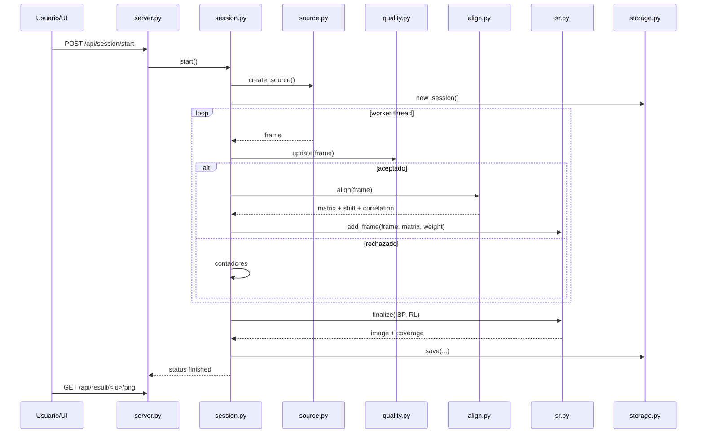

# SuperFoto UNO Q — Documentación de desarrollador

**Versión:** 1.0.0
**Audiencia:** quien va a leer, mantener o extender el código.
**Estado:** auditoría aprobada sin incidencias.

---

## 1. Visión general

El sistema tiene dos ejecutables independientes:

1. **Aplicación Linux** (`app/server.py` + `app/*.py` + `web/`): captura,
   alinea, fusiona, postprocesa y sirve la UI/API. Es el 99 % del proyecto.
2. **Sketch Zephyr** (`sketch/superfoto_mcu/superfoto_mcu.ino`): anima la
   matriz LED 13×8. No se comunica con la app Linux en esta versión.

No hay base de datos, ni servicios externos, ni dependencias de Python fuera de
OpenCV y NumPy. El servidor HTTP es `http.server.ThreadingHTTPServer` de la
stdlib.

### Principios de diseño

- **Cero instalación en la placa:** la UNO Q no tiene pip utilizable; todo debe
  correr con Debian + `python3-opencv` + `python3-numpy`.
- **Fallar con mensajes útiles:** fuentes ausentes, disco lleno, cámara Venus,
  escena en movimiento y frames insuficientes tienen mensajes en español.
- **Honestidad en las métricas:** el benchmark usa ground truth band-limitado y
  el baseline es bicúbico de un frame, no el ground truth perfecto.
- **Convivencia:** puerto 8010, nunca 8000 (`detector-tarjetas`), sin sudo.
- **Trazabilidad:** cada sesión deja `session.json` con parámetros y métricas.

---

## 2. Estructura del código

```
app/
├── config.py     # Config dataclass, defaults, env, validación
├── source.py     # Fuentes de frames + parser MJPEG + ground truth sintético
├── quality.py    # Gate de calidad por frame
├── align.py      # Registro subpíxel (fase + ECC)
├── sr.py         # Fusión, IBP, Richardson-Lucy, PSNR/SSIM
├── session.py    # Orquestador y máquina de estados
├── storage.py    # Persistencia atómica y limpieza
├── server.py     # API HTTP + estáticos
└── discover.py   # Descubrimiento de IP Webcam en la LAN
web/
├── index.html    # UI (una sola página)
├── app.js        # Estado, polling, visor, descargas
├── style.css     # Estética sobria
└── favicon.svg
sketch/superfoto_mcu/superfoto_mcu.ino
scripts/          # deploy, servicio.sh, prueba real, CLI, benchmark, captura, run_local
tests/            # 105 funciones de prueba
```

### Mapa de dependencias

```
server.py ──> session.py ──> source.py
   │             │  │  │
   │             │  │  └──> sr.py ──> (cv2, numpy)
   │             │  └─────> align.py
   │             └────────> quality.py
   └──> storage.py
config.py <── todos
discover.py <── source.py / server.py
```

---

## 3. Flujo de datos



### Secuencia de una sesión

1. `AppState.start_session(payload)` valida que no haya otra sesión.
2. `SuperFotoSession.start()` crea la fuente y la sesión de storage, y lanza el
   hilo `superfoto-worker`.
3. El worker ejecuta `_capture_loop()`:
   - lee frames de la fuente;
   - actualiza el `QualityGate`;
   - el primer frame aceptado inicializa `SubpixelAligner` y `SuperResolver`;
   - cada frame aceptado se alinea y se acumula con un peso;
   - publica preview cada 0.35 s y loguea cada 25 aceptados.
4. Al terminar por frames, duración, `max_elapsed_s` o stop, llama a
   `_process_and_save()`.
5. `SuperResolver.finalize()` aplica IBP, RL y postproceso; devuelve imagen y
   cobertura.
6. `Storage.save()` escribe los artefactos de forma atómica y, al final,
   `session.json` como marcador de completitud.
7. La UI hace polling de `/api/status` cada 700 ms y de sesiones cada 6 s.

---

## 4. Módulos y API interna

### 4.1 `app/config.py`

Constantes principales:

| Constante | Valor | Uso |
|---|---|---|
| `MIN_SCALE` / `MAX_SCALE` | 1.0 / 2.0 | Rango de escala |
| `MAX_OUTPUT_PIXELS` | 32 000 000 | Tope de salida |
| `MAX_ACCUMULATOR_BYTES` | 700 MB | Tope de RAM |
| `QUALITY_PERCENTILE` | 60.0 | Umbral adaptativo |
| `SHARPNESS_ROI_RATIO` | 0.5 | ROI central |
| `MAX_CLIPPED_RATIO` | 0.05 | Tope de píxeles quemados |
| `MIN_CONTRAST_STD` | 3.0 | Contraste mínimo |
| `ALIGN_SCALE` | 0.5 | Pirámide de fase |
| `MAX_SHIFT_PX` | 32.0 | Shift máximo |
| `MIN_CORRELATION` | 0.35 | Correlación mínima |
| `PSF_SIGMA` | 0.6 | PSF por defecto |
| `RL_ITERATIONS` | 15 | Iteraciones RL |
| `REFINE_ITERATIONS` | 8 | Iteraciones IBP |
| `DETECTOR_TARJETAS_PORT` | 8000 | Puerto prohibido |

`Config` es un `@dataclass` con todos los parámetros. `Config.load()` aplica,
en orden: defaults → `config.json` en `BASE_DIR` → variables de entorno.
`validate()` normaliza y acota; **nunca lanza**. `to_dict()` serializa.

Propiedades:

```python
config.sessions_dir   # <data_dir>/sessions
config.previews_dir   # <data_dir>/previews
config.ensure_dirs()  # crea ambas
```

Variables de entorno: `SUPERFOTO_HOST`, `PORT`, `DATA_DIR`, `SESSIONS_KEEP`,
`MIN_FREE_MB`, `SCALE`, `MAX_OUTPUT_PIXELS`, `QUALITY_PERCENTILE`,
`PSF_SIGMA`, `RL_ITERATIONS`, `REFINE_ITERATIONS`, `FRAME_TIMEOUT_MS`,
`TARGET_FRAMES`, `DURATION`, `SOURCE`, `SOURCE_URL`, `SOURCE_PATH`,
`DISCOVER_SUBNET`, `DISCOVER_TIMEOUT`, `LOG_LEVEL`, `USE_ECC`.

### 4.2 `app/source.py`

Contrato `FrameSource`:

```python
class FrameSource(Protocol):
    def is_open(self) -> bool: ...
    def read(self) -> tuple[bool, np.ndarray | None]: ...
    def stop(self) -> None: ...
    @property
    def meta(self) -> dict: ...
```

#### `MJPEGStreamParser`

Parser incremental de `multipart/x-mixed-replace`:

- detecta el boundary (`--myboundary` por defecto);
- usa `Content-Length` si está presente; si no, busca el boundary siguiente;
- tolera basura entre partes y chunks fragmentados;
- limita el buffer a 32 MB y cuenta frames/descartados.

#### `normalize_ip_webcam_url(value)`

Canoniza la IP/URL de **cualquier** teléfono a `http(s)://host:puerto/video`:

| Entrada | Salida |
|---|---|
| `<IP_DEL_TELEFONO>` | `http://<IP_DEL_TELEFONO>:8080/video` |
| `<IP_DEL_TELEFONO>:8080` | `http://<IP_DEL_TELEFONO>:8080/video` |
| `http://<IP_DEL_TELEFONO>:8080` | `http://<IP_DEL_TELEFONO>:8080/video` |
| `http://<IP_DEL_TELEFONO>:8080/photo.jpg` | `http://<IP_DEL_TELEFONO>:8080/video` |
| `https://cam.example/video` | `https://cam.example:8080/video` |
| `http://host:8080/cam/video` | se conserva `/cam/video` |

Reglas: antepone `http://` si falta esquema, usa `8080` si falta puerto, un path
vacío/`/`/`/photo.jpg` pasa a `/video`, y el sufijo se canoniza a minúsculas.
Rechaza (`SourceError`, `kind="invalid"`) esquemas distintos de http/https, host
vacío o con espacios, puertos fuera de 1–65535 y valores vacíos, con mensajes en
español listos para mostrar en la UI.

`ip_webcam_photo_url(url)` deriva el still (`/photo.jpg`) conservando el prefijo.
`probe_photo(value, timeout=3.0)` descarga y decodifica ese still y devuelve
`{ok, url, photo_url, resolution:[alto,ancho], content_type, bytes}`; usa
`SourceError` con `kind` = `invalid` | `connection` | `decode`. Es la base de
`GET /api/probe`.

`IPCameraSource` normaliza en el constructor: `url` es la URL canónica, `base_url`
el host:puerto y `photo_url` el still. **Requiere `start()`** (la sesión lo llama):
sin él, el hilo lector no entrega frames.

#### `IPCameraSource`

```python
IPCameraSource(url, timeout=5, frame_timeout_ms=5000,
               reconnect_backoff=(1, 30), prefer_still=True,
               max_still_stale_s=2)
```

- Hilo lector de `/video` (MJPEG).
- Hilo de stills de resolución completa en `/photo.jpg` cada 2 s.
- Reconexión con backoff exponencial ×1.7, entre 1 y 30 s.
- `read()` espera un frame nuevo o agota `frame_timeout_ms`.
- `meta` incluye `kind="ip_webcam"`, URLs, estado, reconexiones, fps y forma.

`probe_ip_camera(url, timeout=1.2)` consulta `/status.json` y, como fallback,
`/video`; devuelve `{ok, url, status, resolution, error}`.

#### `VideoFileSource`

```python
VideoFileSource(path, loop=True, max_frames=None)
```

No carga el video completo: usa `cv2.VideoCapture` y avanza frame a frame.
`meta` incluye `total_frames`, `fps`, `frame_shape`, `looping`.

#### `WebcamSource`

```python
WebcamSource(index=0, width=None, height=None, fps=None, validate=True)
```

- Descarta dispositivos que no son cámara leyendo
  `/sys/class/video4linux/videoN/name` y comparando con
  `NON_CAMERA_PATTERNS = ("venus", "decoder", "qcom", "qualcomm", "encod",
  "codec")`.
- Prueba `CAP_V4L2` y luego el backend por defecto.
- Configura fourcc MJPG.
- Valida 8 frames con `std > 0.5`; si no, lanza `SourceError` con la lista de
  dispositivos y una explicación.

#### `ImageFolderSource`

Lee imágenes ordenadas alfabéticamente, con loop opcional.

#### `SyntheticSource` y `make_ground_truth`

`make_ground_truth(h, w, seed, band_limit_sigma=0.45)` genera una escena
**band-limitada** con gradientes, gratings (0.08–0.185 ciclos/px), discos,
anillos, líneas finas, texto y textura correlacionada. El desenfoque final es
deliberado: un ground truth con ruido blanco píxel a píxel sería imposible de
recuperar y haría tramposo el benchmark.

`SyntheticSource` aplica jitter subpíxel en la grilla del GT, downsample
`INTER_AREA`, ruido gaussiano y round-trip JPEG. Es determinista por `seed`.

#### Fábrica

```python
normalize_source(kind) -> str
create_source(kind, args, config, allow_discover=True) -> FrameSource
```

Aliases: `auto`, `ip/ipcam/ip_webcam/webcam_ip`, `file/video`,
`folder/images`, `webcam/usb/v4l2`, `fake/synthetic/demo`.

`auto` prueba en orden: URL configurada → descubrimiento LAN → archivo
configurado → error explicativo.

### 4.3 `app/quality.py`

```python
class QualityGate:
    def __init__(self, percentile=60, min_sharpness=None, roi_ratio=0.5,
                 max_clipped_ratio=0.05, min_contrast_std=3.0,
                 warmup=8, history=120)
    def update(self, frame) -> dict
    def measure(self, frame) -> dict
    def set_adaptive(self, enabled: bool) -> None
    def reset(self) -> None
```

- `sharpness`: varianza del Laplaciano en el ROI central.
- `clipped_ratio`: fracción de píxeles ≥250 en cualquier canal.
- `contrast`: desviación estándar de la luminancia.
- Umbral adaptativo: percentil de la ventana de 120 valores de nitidez, pero
  solo después de 8 frames de warmup. Antes usa `min_sharpness` o 0.
- `update()` devuelve `{sharpness, accept, reason, exposure_ok, threshold,
  clipped_ratio, contrast, mean_luma}`.
- Razones de rechazo: `overexposed`, `low_contrast`, `blurry`, `empty`.
- `RLock` para acceso concurrente (el worker actualiza, el servidor lee stats).

**Detalle importante:** la ventana guarda la nitidez de **todos** los frames
vistos, no solo de los aceptados. Si guardara solo aceptados, el umbral se
volvería auto-referencial y rechazaría cada vez más.

### 4.4 `app/align.py`

```python
class SubpixelAligner:
    def __init__(self, ref_frame, scale=0.5, max_shift=32.0, min_corr=0.35,
                 use_ecc=True, ecc_motion="translation", ecc_iters=25,
                 ecc_eps=1e-4, ecc_max_side=360)
    def align(self, frame) -> dict
    def apply_matrix(frame, matrix, out_shape) -> np.ndarray  # helper
```

Dos etapas:

1. **Fase:** gris + ventana Hann + `cv2.phaseCorrelate` a `scale=0.5`.
   Devuelve traslación y respuesta. Rechaza si:
   - `gray.std() < 4.0` (`low_texture`);
   - respuesta < `min(0.5, max(0.05, min_corr*0.5))`;
   - shift > `max_shift`.
2. **ECC:** recorte central de hasta 360 px a resolución nativa, inicializado
   con la traslación de fase. `findTransformECC` con modo traslación. Si
   `cc < 0`, se queda con la fase.

La matriz resultante mapea **móvil → referencia**. Para ECC se invierte el warp
y se recompone el offset del recorte central.

Salida:

```python
{
  "matrix": np.ndarray(2, 3),
  "shift": (dx, dy),
  "correlation": float,
  "valid": bool,
  "method": "phase" | "ecc" | "none",
  "reason": "ok" | "empty" | "low_texture" | "low_correlation" | "max_shift",
  "texture": float,
}
```

Error típico: ~0.2 px con fase, ~0.04 px con ECC.

### 4.5 `app/sr.py`

#### `SuperResolver`

```python
SuperResolver(ref_shape, scale, max_output_pixels=32_000_000,
              max_accumulator_bytes=700*1024*1024,
              interp=cv2.INTER_LINEAR,
              max_store_frames=32, max_store_bytes=96*1024*1024,
              seed=12345)
```

Presupuesto: `_BYTES_PER_OUTPUT_PX = 18` (3 canales float32 = 12 B, peso
float32 = 4 B, contador uint16 = 2 B). `_clamp_scale()` reduce la escala si no
entra en `max_output_pixels` o `max_accumulator_bytes`; si aun a 1.0 no entra,
lanza `ValueError`.

`interp` es la interpolación de la reproyección por frame: `INTER_LINEAR` por
defecto. Con `INTER_LANCZOS4` cada frame costaba ~1,7 s en la UNO Q (4,6 MP de
salida) y la captura quedaba limitada a menos de 1 frame/s; con lineal baja a
~0,4 s y entran 20–30 frames en una sesión normal. El refinamiento posterior
(IBP + RL) recupera el detalle que la interpolación lineal no aporta.

`add_frame(frame, matrix, weight)`:

1. Convierte a BGR y redimensiona a la forma de referencia si hace falta.
2. Escala la matriz al alta resolución:
   `m_hr = [linear*S, trans*S + (S-1)/2]`. El término `(S-1)/2` compensa la
   convención de centro de píxel de `cv2.resize`/`warpAffine`.
3. `warpAffine` con Lanczos4 y borde reflect.
4. `acc += warped * weight`; `wsum += mask * weight`.
5. Incrementa `count` de forma saturante (`uint16`, tope 65535).
6. Guarda una muestra en un buffer acotado por reservoir sampling (máx. 32
   frames o 96 MB) para el refinamiento posterior.

`refine(iterations=8, lam=0.7)` — IBP:

- Simula el proceso directo: desenfoca la estimación con una caja gaussiana de
  `sigma_box = 0.5 * scale`, la reproyecta a cada frame de baja resolución y
  calcula el residual.
- Reproyecta el residual y corrige:
  `x = clip(x + (lam / total_w) * residual)`.
- Trabaja sobre los frames guardados, no sobre todos los capturados.

`finalize(refine_iterations=8, psf_sigma=1.0, rl_iterations=15,
white_balance=False, denoise_chroma=True, unsharp=False)`:

- `result()` divide `acc / wsum` y rellena los píxeles sin cobertura con el
  bicúbico del frame de referencia.
- Aplica postproceso en orden: balance de blancos → RL → unsharp → croma.
- Devuelve `(imagen, cobertura)`.

`coverage_stats()` devuelve `{coverage_1, coverage_4, coverage_16,
mean_count, frames}`. `coverage_16` es la métrica exigente: fracción de píxeles
con al menos 16 muestras.

#### Postproceso

| Función | Firma | Detalle |
|---|---|---|
| `richardson_lucy_luminance` | `(img, sigma=1.0, iterations=15, damping=1.0)` | Lab L con offset +1; ganancia clip 0.5–2.0 |
| `unsharp_luminance` | `(img, sigma1=1.0, strength1=0.5, sigma2=4.0, strength2=0.3)` | Multiescala |
| `chroma_denoise` | `(img, h=5, hcolor=5)` | Bilateral en a/b a media resolución |
| `gray_world_balance` | `(img, max_cast=1.35)` | Balance neutro acotado |
| `_gaussian_psf` | `(sigma)` | Radio `ceil(3σ)` |

#### Métricas

`psnr(a, b, data_range=255)` devuelve 99.0 si el MSE es ~0.
`ssim(a, b)` es una implementación propia global (ventana gaussiana 11×11,
σ=1.5, C1/C2). Se evita `scipy`/`skimage` a propósito.

### 4.6 `app/session.py`

```python
SuperFotoSession(config, source=None, storage=None, source_kind="auto",
                 source_args=None, scale=None, quality_percentile=None,
                 min_sharpness=None, psf_sigma=None, rl_iterations=None,
                 refine_iterations=None, target_frames=None,
                 duration_s=None, label="")
```

Estados: `idle`, `starting`, `capturing`, `processing`, `finished`, `error`,
`stopped`.

Métodos:

| Método | Comportamiento |
|---|---|
| `start()` | Crea fuente y storage, lanza el hilo, devuelve `{ok, session_id, status, scale}` |
| `request_stop()` | Marca el evento; no bloquea |
| `stop(wait=True, timeout=900)` | Espera el postproceso |
| `status` (property) | Snapshot para la API |
| `session_summary(status)` | Línea de resumen |

Lógica de captura:

- Corta por `target_frames`, `duration_s` o `max_elapsed_s` (300 s por defecto;
  el CLI lo pone en 0).
- 40 fallos de lectura consecutivos → error de fuente.
- Peso de fusión:
  `clip((sharpness/threshold)^0.5, 0.3, 3.0) * clip(1 - 2*clipped_ratio, 0.4, 1.0)`.
- Preview cada 0.35 s; log cada 25 aceptados.

Detección de escena en movimiento:

```python
scene_motion_warning(seen, align_invalid, accepted) -> bool
```

Avisa si hay al menos 30 frames evaluados y:
`align_invalid/seen > 0.5` **o** `align_invalid/(accepted+align_invalid) > 0.5`.
En ese caso fusiona solo el segmento estable y agrega un `advice` visible.

Artefactos:

- `_make_thumb(max_side=320)`: miniatura con `INTER_AREA`.
- `_make_compare(reference, result, frames=0)`: recorte de 480x360 tomado de
  la zona con MÁS detalle de la imagen (no del centro), ampliado 2x con
  `INTER_NEAREST` en ambos paneles, separador blanco de 8 px y rótulos
  `BICUBICO 1 frame` / `SUPERFOTO N frames | detalle +X%`. Si el resultado
  mide menos de 16 px o la referencia está vacía devuelve un array vacío.
  **Sin acentos**: `cv2.putText` no maneja UTF-8.
- `_detail_crop_origin(image, cw, ch)`: elige la ventana `cw x ch` con mayor
  energía de gradiente (Sobel sobre una Gaussiana σ=1.2, sumada con
  `cv2.integral`). Evita recortar una zona lisa donde nada se ve.
- `_structural_sharpness(panel)`: percentil 99 de la magnitud del gradiente
  tras suavizar σ=1.5. Es la métrica que se muestra en el rótulo: la varianza
  del Laplaciano se infla con el grano del postproceso y llegó a mentir 9x
  sobre una pareja visualmente idéntica.
- `_soft_source_advice(sharpness)`: aviso cuando la referencia tiene
  `laplacian_variance < SOFT_SOURCE_SHARPNESS` (45). Una fuente desenfocada no
  tiene detalle que la superresolución pueda recuperar; el aviso lo dice en la
  UI y en `advice`. La nitidez medida queda en `metrics.reference_sharpness`.

Mensajes de cierre (en orden de prioridad):

- `"La escena se mueve demasiado..."` si hay aviso de movimiento.
- `"Superfoto lista con N frames, pero la fuente salio desenfocada: revisa el
  aviso antes de repetir"` si `advice` es el aviso de fuente blanda.
- `"Pocos frames utiles (N de M)..."` si se aceptaron menos de 8 y hubo
  rechazos; `"Superfoto lista con N frames (captura corta)..."` si se
  aceptaron todos.
- `"Superfoto lista con N frames; X se descartaron..."` si
  `align_invalid > 3 * accepted`.
- `"Superfoto lista"` en el caso normal.

### 4.7 `app/storage.py`

```python
Storage(base, keep=3, previews_limit=8, min_free_mb=500, fsync=True)
```

- IDs válidos: `^[0-9]{8}_[0-9]{6}(_[A-Za-z0-9]{1,24})?$`.
- `new_session(suffix)`: `YYYYmmdd_HHMMSS[_suffix]`.
- `save(session_id, image, thumb, compare, meta, reference, coverage,
  jpeg_quality=95)`: escribe PNG, JPEG, thumb, compare, reference, coverage y
  por último `session.json`. Estima necesidad con
  `image.nbytes * 0.75 + 2 MB`.
- Escritura atómica: `<stem>.tmp<suffix>` + `fsync` + `os.replace`. Si algo
  falla, borra el directorio incompleto y no deja `.tmp`.
- `_ensure_free_space()`: si falta espacio, purga sesiones viejas
  (`keep=1`, protegiendo la actual); si aun así no alcanza, lanza
  `StorageError` con los MB faltantes.
- `file_path(session_id, key)`: allowlist de claves + contención de path.
- `_describe()`: metadatos para la API, **nunca** rutas absolutas. Devuelve
  `rel: "sessions/<name>"`, `urls`, `bytes_total`, `has_json`, etc.
- `cleanup()`, `prune_previews()`, `disk_usage()`.

### 4.8 `app/server.py`

- `ThreadingHTTPServer` con `daemon_threads=True`.
- `AppState` guarda la sesión actual, el storage, el lock, el uptime y el estado
  de descubrimiento.
- Estáticos con allowlist: `index.html`, `app.js`, `style.css`, `favicon.svg`.
- `query_int(query, name, default)` usa `urllib.parse.parse_qs`, sin `cgi`.
- JSON de entrada máximo 1 MB; cuerpo vacío aceptado.
- Errores JSON: `{"ok": false, "error": "...", "status": N}`.

Rutas y códigos:

| Ruta | Método | Código | Notas |
|---|---|---|---|
| `/api/health` | GET | 200 | `data_dir_name`, no ruta absoluta |
| `/api/status` | GET | 200 | Snapshot de la sesión |
| `/api/sources` | GET | 200 | Labels + defaults |
| `/api/session/start` | POST | 202 / 400 / 409 | 400 `SourceError`; 409 sesión activa |
| `/api/session/stop` | POST | 200 | `?wait=1` espera hasta 300 s |
| `/api/session/latest` | GET | 200 / 404 | Última finalizada |
| `/api/sessions` | GET | 200 | Historial sin rutas absolutas |
| `/api/preview` | GET | 200 | JPEG; placeholder si no hay frame |
| `/api/probe?url=<ip\|url>` | GET | 200 / 400 / 502 | Normaliza, descarga `/photo.jpg` y decodifica; 400 URL inválida, 502 sin conexión o respuesta no-imagen |
| `/api/discover` | GET | 200 | Barrido LAN |
| `/api/result/<id>/<key>` | GET | 200 / 404 | `png`, `jpg`, `thumb`, `compare`, `reference`, `coverage`, `json` |

Payload de `start`:

```json
{
  "source": "ip",
  "args": {"url": "http://<IP_DEL_TELEFONO>:8080"},
  "scale": 1.5,
  "quality_percentile": 55,
  "min_sharpness": null,
  "psf_sigma": 0.6,
  "rl_iterations": 15,
  "refine_iterations": 8,
  "target_frames": 0,
  "duration_s": 300,
  "label": "estoma"
}
```

`url`, `path`, `index`, `width`, `height`, `frames`, `seed` y `duration` también
se aceptan en el nivel superior y se mueven a `args` por compatibilidad.
`args.url` pasa por `normalize_ip_webcam_url`, así que acepta `IP`,
`IP:puerto` o la URL completa.

La UI guarda la última IP en `localStorage` (`superfoto.ipUrl`), valida que no
esté vacía cuando la fuente es `ip`, y usa `/api/probe` para el botón
**Probar conexión**.

### 4.9 `app/discover.py`

```python
discover_ip_webcam(subnet=None, ports=(8080, 8081), timeout=0.8,
                   max_workers=64, hosts=None, max_seconds=6.0) -> list[dict]
```

- Barrido `/24` con `ThreadPoolExecutor`, sin asyncio.
- Filtro TCP rápido antes del HTTP.
- Considera cámara si `/status.json` tiene firma de IP Webcam o si `/video`
  responde multipart/JPEG.
- Devuelve resultados ordenados por latencia; nunca lanza.
- `discover_ip_webcam_async` corre el barrido en un thread.

### 4.10 `web/app.js`

Estado en un objeto `state` (zoom, offset, imagen, sesión, polling). Sin
frameworks, sin recursos externos, sin `innerHTML` dinámico (test explícito).
El visor usa `<canvas>`: `imageSmoothingEnabled = zoom < 2`, zoom máximo 8,
rueda con factor 1.18, botones Ajustar/1:1. Descargas por
`/api/result/<id>/<key>` y recortes generados en canvas.

### 4.11 `sketch/superfoto_mcu/superfoto_mcu.ino`

- API cruda de `Arduino_LED_Matrix`: `setGrayscaleBits(3)` + `draw(canvas)`.
- Canvas 13×8, valores 0–7.
- Modos `MODE_IDLE`, `MODE_CAPTURE`, `MODE_PROCESS`, `MODE_DONE`.
- Comandos serie `I`, `C`, `P`, `D`, `A`; timeout de 20 s a demo; ciclo de 7 s.
- Heartbeat en la esquina cada 500 ms; arranque con barrido de izquierda a
  derecha.
- `delay(33)` → ~30 fps.
- RAM ~650 B, flash ~2.9 KB.

### 4.12 `scripts/servicio.sh`

Envoltorio de ciclo de vida del servidor Linux. No es parte de la app: es la
capa operativa que permite arrancar, parar y consultar el proceso sin `sudo`.
La guía de usuario completa está en [`servicio.md`](servicio.md).

**Comandos:** `start`, `stop`, `restart`, `status`, `logs [N]`,
`boot-enable`, `boot-disable`, `boot-status`, `help`. Comando desconocido →
ayuda y código `2`.

**Variables:** `SUPERFOTO_PORT` (8010), `SUPERFOTO_HOST` (0.0.0.0),
`SUPERFOTO_DATA_DIR` (`<proyecto>/data`), `PYTHON` (`python3`). El puerto 8000
está prohibido por convivencia con `detector-tarjetas`.

**Estado:**

| Archivo | Rol |
|---|---|
| `data/superfoto.pid` | PID del servidor |
| `data/server.log` | stdout/stderr, append, rotado a 5 MB |
| `data/servicio.lock` | `flock` para excluir `start`/`stop` simultáneos |

**Ciclo de vida:**

1. `start` toma el lock; si el PID file es válido, no hace nada.
2. Si el puerto está ocupado, busca el proceso con `pgrep -f app/server.py`.
   Si es del proyecto, lo **adopta** escribiendo el PID file (caso típico:
   servidor dejado por `deploy_unoq.sh`). Si es ajeno, aborta sin matarlo.
3. Verifica intérprete, `app/server.py` e import de `cv2`/`numpy`.
4. Lanza con `nohup ... 9>&- &` y guarda `$!`.
5. Hace health check HTTP a `127.0.0.1:<puerto>/api/health` durante 10 s.

El detalle `9>&-` es crítico: cierra en el hijo el descriptor del `flock`. Sin
eso el servidor retiene el lock mientras vive y `stop`/`restart` fallan con
“otra operacion de servicio esta en curso”. Corregido y verificado en la placa.

`stop` valida el PID leyendo `/proc/<pid>/cmdline` (debe contener
`app/server.py`) antes de enviar `TERM`; espera 10 s y recién entonces usa
`KILL`. `status` devuelve `0` si corre y `3` si está detenido. `boot-enable`
instala una línea `@reboot` idempotente en el crontab del usuario; no toca
systemd ni requiere privilegios.

**Pruebas:** [`tests/test_service_script.py`](../tests/test_service_script.py)
cubre existencia/ejecutable, `bash -n`, comandos y guardas, `help`, `status`
con directorio temporal y la prohibición del 8000 (6 tests; suite total 105).

---

## 5. Formato de `session.json`

Esquema real (sesión de microscopía, valores abreviados):

```json
{
  "session_id": "20261114_204339_file",
  "created_at": "2026-11-14T20:52:27Z",
  "source": {
    "kind": "file",
    "meta": {
      "kind": "video_file",
      "path": "data/videos/leuco_micro_estable_19s_1080p.mp4",
      "frames": 0,
      "total_frames": 487,
      "fps": 25.0,
      "frame_shape": [1080, 1920],
      "looping": false
    }
  },
  "scale": 2.0,
  "requested_scale": 2.0,
  "frames_accepted": 186,
  "elapsed_seconds": 459.51,
  "metrics": {
    "frames_seen": 487,
    "frames_accepted": 186,
    "frames_rejected": 301,
    "align_invalid": 176,
    "elapsed_seconds": 459.51,
    "process_seconds": 68.64,
    "effective_scale": 2.0,
    "output_pixels": 8294400,
    "coverage": {
      "coverage_1": 1.0,
      "coverage_4": 1.0,
      "coverage_16": 1.0,
      "mean_count": 185.89,
      "frames": 186
    },
    "refine_iterations": 8,
    "psf_sigma": 0.6,
    "rl_iterations": 15,
    "stored_frames": 16,
    "shift_mean_px": 0.657,
    "shift_max_px": 1.552
  },
  "label": "",
  "params": {
    "quality_percentile": 20,
    "min_sharpness": null,
    "target_frames": 0,
    "duration_s": 0,
    "max_shift_pixels": 32,
    "min_correlation": 0.35,
    "use_ecc": true
  },
  "files": {
    "png": "superfoto.png",
    "jpg": "superfoto.jpg",
    "thumb": "thumb.jpg",
    "compare": "compare.jpg",
    "reference": "reference.jpg",
    "coverage": "coverage.png"
  },
  "bytes": {
    "png": 10745159,
    "jpg": 1687722,
    "thumb": 19438,
    "compare": 84338,
    "reference": 366265,
    "coverage": 15537
  },
  "output_shape": [2160, 3840]
}
```

Notas:

- `files` mapea clave lógica → **nombre de archivo**, no ruta.
- `bytes` mapea la misma clave → tamaño en bytes.
- `session.json` se escribe **al final**; su presencia marca la sesión completa.
- `metrics.coverage` es un objeto anidado, no un escalar.
- En fuentes sintéticas se agrega un bloque `ground_truth` con
  `psnr_superfoto`, `psnr_bicubic`, `ssim_superfoto`, `ssim_bicubic`,
  `gain_db` y `comparable`. Solo es válido si la escala pedida coincide con el
  downsample del GT (`|scale - downsample| <= 0.05`).
- `advice` aparece si hubo aviso de escena en movimiento.

---

## 6. Pruebas

La suite tiene **105 funciones de prueba** y no requiere hardware: usa fuentes
sintéticas, videos temporales y un servidor en un puerto efímero. Incluye 6
pruebas estáticas/de humo del script de servicio.

```bash
python3 -m pytest -q
```

| Archivo | Cobertura |
|---|---|
| `test_source.py` | Parser MJPEG fragmentado/sin Content-Length/basura, reconexión, carpeta, video, fuente faltante, sintética determinista, aliases, listado de devices |
| `test_quality.py` | Borroso vs nítido, umbral explícito, sobreexposición, bajo contraste, adaptativo, concurrencia |
| `test_align.py` | Shift conocido, fase sola, rechazo por shift grande, frame no relacionado, falta de textura, identidad exacta |
| `test_sr_synthetic.py` | GT vs bicúbico, consistencia de fusión online, guardas de escala/memoria, frame vacío, saturación uint16 |
| `test_session.py` | Aviso de movimiento (umbrales y falso positivo), sanitización de rutas absolutas |
| `test_storage.py` | Retención, allowlist, metadatos, ausencia de rutas absolutas, fallo atómico sin archivos parciales, espacio insuficiente, protección de la sesión actual |
| `test_api.py` | Health, start/stop con artefactos, IP offline, estado final, ausencia de rutas absolutas, `query_int`, aviso de escena, historial |
| `test_process_video_cli.py` | Rechazo de negativos, cero y defaults |
| `test_web_static.py` | Sin `innerHTML` dinámico, sin recursos externos, assets locales |
| `test_sketch_source.py` | Solo `Arduino_LED_Matrix`, cuatro estados |
| `test_service_script.py` | `servicio.sh`: ejecutable, `bash -n`, comandos/guardas, `help`, `status` temporal, puerto 8000 |

### Benchmark

```bash
python3 scripts/benchmark_sr.py --quick
```

- `--quick`: GT 1200×900, 120 frames de 600×450.
- Default: GT 4000, 300 frames.
- Escala 2.0, PSF óptica 0.5 px, ruido σ=3, JPEG 88.
- Criterio de aprobación: `gain_db >= 1.5` **y** SSIM final > SSIM bicúbico.
- Imprime tabla por etapa (bicúbico, fusión online, +IBP, +RL).
- `--json` guarda el resultado; `--out-dir` guarda imágenes.

Resultado actual: +6.47 dB (24.34 → 30.81), SSIM 0.9214 → 0.9497.

---

## 7. Decisiones de diseño

| Decisión | Alternativa descartada | Por qué |
|---|---|---|
| `http.server` de la stdlib | Flask/FastAPI | La placa no tiene pip; menos superficie de fallo |
| OpenCV + NumPy del sistema | wheels en venv | No se puede instalar en la placa |
| Parser MJPEG propio | `urllib` + librería | Control de reconexión, timeouts y memoria |
| Fase + ECC | Solo fase o solo ECC | Fase es robusta y global; ECC da precisión subpíxel |
| Drizzle por remap inverso | Interpolación directa | Deposita muestras reales en la grilla fina |
| IBP sobre buffer acotado | IBP sobre todos los frames | RAM y tiempo acotados; 15–32 frames bastan |
| RL solo en luminancia | RL en RGB | Menos artefactos de color y más rápido |
| SSIM/PSNR propios | scipy/skimage | Sin dependencias |
| Escritura atómica | Escritura directa | Nunca dejar sesiones a medias |
| uint16 saturante | uint32 | Mitad de memoria; 65535 muestras sobran |
| Puerto 8010 | 8000 | Convivencia con `detector-tarjetas` |
| `servicio.sh` + cron del usuario | systemd automático | No hay contraseña ni `sudo` en la placa |
| Lock con `flock` + PID validado | Solo PID file | Evita carreras y no mata procesos ajenos |
| Aviso de escena en movimiento | Fallar la sesión | Se conserva el segmento estable |
| Sin rutas absolutas en la API | Devolver paths | Privacidad y portabilidad |
| Zoom 8× digital explícito | Vender "8× óptico" | Honestidad técnica |

---

## 8. Cómo extender

### 8.1 Agregar una fuente

1. Implementar una clase con `is_open()`, `read()`, `stop()` y `meta`.
2. Registrarla en `SOURCE_ALIASES` y `SOURCE_LABELS` (`source.py`).
3. Agregarla a `create_source()` y a `_describe_source()` si aplica.
4. Agregar la opción en `web/index.html` y el manejo en `syncVisibility()`.
5. Test en `tests/test_source.py` con un archivo o stream simulado.
6. Documentar en `docs/datasheet.md` y en la tabla de fuentes del README.

### 8.2 Agregar un parámetro

1. Campo en `Config` + default en `config.py`.
2. Variable `SUPERFOTO_*` en `Config.load()`.
3. Clamp en `validate()`.
4. Campo en `config.example`.
5. Aceptarlo en el payload de `server.py` (`start_session`).
6. Agregarlo a `SuperFotoSession.__init__` y a `params` del `session.json`.
7. Control en la UI (`index.html` + `app.js` + `updateSliderLabels`).
8. Test de API y de sesión.

### 8.3 Agregar un postproceso

1. Implementar la función en `sr.py` (preferentemente sobre luminancia).
2. Agregar parámetro a `finalize()` con default conservador.
3. Exponerlo en `Config`, API y UI solo si el costo se justifica.
4. Agregar un test sintético que verifique que no degrada PSNR/SSIM.
5. Documentar el orden del pipeline.

### 8.4 Agregar una métrica

1. Calcularla en `_process_and_save()` y guardarla en `metrics`.
2. Exponerla en `status` si debe verse en vivo.
3. Mostrarla en el panel de progreso (`web/app.js`).
4. Actualizar el esquema de `session.json` en este documento.

### 8.5 Agregar un artefacto

1. Clave en `RESULT_FILES` (`storage.py`).
2. Escritura en `Storage.save()` con nombre y calidad.
3. Allowlist en `server.py`.
4. Enlace/descarga en la UI.
5. Test de storage y de API.

### 8.6 Agregar un estado al sketch

1. Nueva constante `MODE_*`.
2. Patrón en `drawMode()`.
3. Comando en `handleCommand()`.
4. Actualizar la tabla de estados del README.
5. Verificar que `test_sketch_source.py` siga pasando (busca cuatro estados;
   si agregás uno, actualizá el test).

---

## 9. Notas sobre Zephyr y la UNO Q

- El sketch corre en el **STM32U585** con Zephyr RTOS, no en el Linux.
- `Arduino_LED_Matrix` de UNO Q expone `setGrayscaleBits()` y `draw()` con un
  canvas de 13×8. No se usa `ArduinoGraphics`.
- **No hay librerías AVR:** `avr/pgmspace.h`, `EEPROM`, `SoftwareSerial` y
  similares no existen en este core.
- **3.3 V:** cualquier periférico externo debe ser compatible o usar level
  shifter.
- **ADC de 12 bits (0–4095):** no se usa en este proyecto, pero es la
  diferencia que rompe sketches portados del Uno clásico.
- **Upload:** `arduino-cli upload --fqbn arduino:zephyr:unoq` usa ADB +
  OpenOCD por SWD. Requiere que `adb` vea la placa.
- **Puertos:** `/dev/ttyACM0` es la consola Linux/upload; `/dev/ttyHS1` es el
  enlace interno MCU–Linux. Esta versión no usa el segundo.
- **`/dev/video0-1` no son cámaras:** son decodificadores Venus. El filtro por
  sysfs es intencional y está testeado.
- El sketch es **opcional**: la app Linux no depende de él. Si el upload falla,
  la superfotografía sigue funcionando.

---

## 10. Deuda técnica y limitaciones conocidas

1. **Sin autenticación ni TLS.** Solo LAN de confianza.
2. **Una sola sesión.** No hay cola ni múltiples workers.
3. **Modelo de alineación traslacional.** ECC está configurado en modo
   traslación; rotaciones pequeñas no se compensan. Suficiente para cámara fija,
   insuficiente para mano alzada.
4. **Salida 8-bit.** No hay 16-bit ni TIFF; para uso científico estricto haría
   falta otra profundidad.
5. **`max_elapsed_s=300` en la UI.** Para capturas más largas hay que cambiar la
   config o usar el CLI (que lo pone en 0).
6. **Sin reanudación.** Si el servicio muere a mitad de sesión, se pierde.
7. **Calidad heurística.** El gate mide nitidez global en el ROI central; no
   detecta desenfoque selectivo ni movimiento local.
8. **Descubrimiento limitado.** Solo `/24`, puertos 8080/8081, timeout corto.
9. **UI en español hardcodeada.** No hay i18n.
10. **Sin borrado de sesiones por API.** Se limpia por retención o a mano.
11. **Etiquetas de `compare.jpg` sin acentos.** Limitación de `cv2.putText`.
12. **Sin CI.** Los tests se corren a mano; no hay workflow.
13. **Sketch aislado.** No hay feedback Linux → MCU por `/dev/ttyHS1`.
14. **Pico de RAM ~900 MB–1.2 GB.** Cabe en 2.4 GB libres, pero no deja mucho
    margen para procesos extra.
15. **Sin GPU.** Todo es CPU; la placa prioriza bajo consumo.

---

## 11. Depuración rápida

| Qué mirar | Dónde |
|---|---|
| Estado del proceso | `scripts/servicio.sh status` |
| Estado y contadores | `GET /api/status` |
| Disco y versiones | `GET /api/health` |
| Log del servicio | `scripts/servicio.sh logs 100` o `data/server.log` |
| Sesiones guardadas | `data/sessions/<id>/session.json` |
| Cámara detectada | `GET /api/sources`, `python3 -c` con `list_video_devices()` |
| Shift y cobertura | `metrics.shift_mean_px`, `metrics.coverage` |
| Benchmark | `python3 scripts/benchmark_sr.py --quick` |
| Tests | `python3 -m pytest -q` |

Para reproducir un caso sin hardware:

```bash
python3 scripts/process_video.py --input /ruta/video.mp4 --fast --max-frames 30
```

Para inspeccionar el parser MJPEG sin cámara, los tests de `test_source.py`
levantan servidores locales y cubren chunks fragmentados.

---

## 12. Convenciones

- Python 3.10+ con type hints (`from __future__ import annotations`).
- Sin dependencias externas nuevas.
- Mensajes de usuario en español; logs técnicos también.
- Nombres de archivos y claves de API en inglés; documentación en español.
- No exponer rutas absolutas en respuestas HTTP ni en `session.json`.
- Cualquier cambio de algoritmo debe pasar el benchmark (+1.5 dB y SSIM).
- Cualquier cambio de UI debe mantener los tests de `test_web_static.py`
  (sin `innerHTML` dinámico, sin recursos externos).
